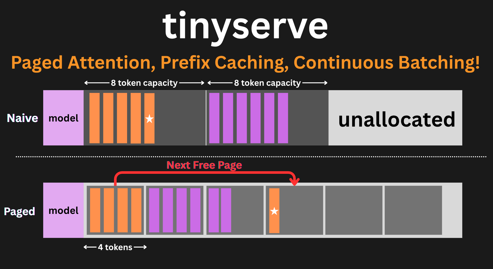

# tinyserve


LLM inference is all the rage these days! Whether it is user-side inference or rollout generation for RL post-training, being able to serve LLMs fast matters. tinyserve is a small, readable, vLLM-style inference engine: the whole scheduler, KV cache, model, tensor parallelism and HTTP server live in one file, `serve.py`, and the GPU kernels live in a second one, `tinykernels.py`.

It is meant to be read. `serve.py` is written as a plain PyTorch reference with the Triton Kernels being the default fast path. We implement:

- **Paged KV Cache** with **Prefix Caching**: Shared prompt prefixes reuse cache blocks instead of recomputing them. 
- **Continuous Batching** with **chunked prefill**, request **preemption** and **async scheduling** (the cpu schedules step n+1 while the GPU runs step n)
- **Triton Kernels Everywhere** (`tinykernels.py`): Paged Attention w/ Split-KV Decoding, fused RMSNorm, q-k-norm + RoPE, SwiGLU, Fused Mixture-of-Experts, and a Fused Sampler. 
- **Full CUDA-Graphs** for decode steps and mixed-prefill
- **Tensor Parallelism** (`-tp`) and **expert parallelism** (`--expert-parallel`) across GPUs
- An **OpenAI-Compatible HTTP Server** (`/v1/completions`, `/v1/chat/completions`) with streaming

Models: Llama-style architectures (`llama`, `qwen2`, `qwen3`) and `qwen3_moe`. Tested on Qwen3-0.6B, 8B, 32B and Qwen3-30B-A3B; other Llama-class models should work but have not been tried yet.

## Install

```bash
pip install torch transformers datasets huggingface_hub safetensors \
            fastapi uvicorn pandas numpy openai httpx
pip install flash-attn --no-build-isolation   # optional
```
`flash_attn` install is needed if you want to test that backend, otherwise we default to the built Triton kernels


## Usage

Every command is `python serve.py <serve|generate> [flags]`:

```
--model Qwen/Qwen3-8B             any HF model of a supported architecture
--attention-backend triton        triton | flash_attn | torch
--no-triton-kernels               run nonfused ops
--no-cuda-graphs                  run every step eagerly
--no-prefix-caching               don't build prefix hash table
--tensor-parallel-size 2          split the model across this many GPUs
--expert-parallel                 MoE with -tp > 1 
--max-model-len 8192              max prompt + output tokens per request
--max-num-seqs 256                max requests in one batch
--max-num-batched-tokens 2048     token budget per step
--gpu-memory-utilization 0.85     fraction of the card the engine may use
--log-stats-interval 10           verbosity frequency
```

## Serve a Model

```bash
python serve.py serve --model Qwen/Qwen3-8B --port 8000

# two GPUs
python serve.py serve --model Qwen/Qwen3-32B -tp 2 --max-model-len 32768

# a mixture-of-experts model, each GPU holding whole experts
python serve.py serve --model Qwen/Qwen3-30B-A3B -tp 2 --expert-parallel
```

## One-off Generation
```bash
python serve.py generate --prompt "The meaning of life is" --max-tokens 64
```
`--temperature`, `--repetition-penalty` and `--repeat-last-n` can be applied here as well

## Python Usage
```python
# assumes already running at localhost:8000
from openai import OpenAI
client = OpenAI(base_url="http://localhost:8000/v1", api_key="unused")
stream = client.chat.completions.create(
    model="Qwen/Qwen3-8B",
    messages=[{"role": "user", "content": "Describe the transformer model"}],
    max_tokens=1024,
    stream=True,
)
for chunk in stream:
    delta = chunk.choices[0].delta
    if delta.content is not None:
        print(delta.content, end="", flush=True)
```

## Load Testing

To a running endpoint you can send **Poisson-Distributed** arrivals as if it was real traffic with random gaps. Prompts are instructions sampled from [Alpaca](tatsu-lab/alpaca) and [Dolly](databricks/databricks-dolly-15k) sampled equally across length bins, and optionally behind one of three shared ~256-token system prompts to exercise prefix caching. You can control the rate (`--rate`) at which the requests will hit your endpoint.


```bash
python serve.py serve --model Qwen/Qwen3-8B --port 8000        # in one terminal
python benchmarks/simulate_serving.py --model Qwen/Qwen3-8B --rate 4 --duration 60 --max-tokens 256
```
```
--rate 1.0           mean requests per second
--duration 60        seconds of arrivals
--max-tokens 4096    output limit per request
--bins 1,64,512,2048 prompt-length bin edges, in tokens
--prefix-tokens 256  length of shared system prompt 
--dashboard          also serve a live page
```

## Performance

Everything below is run on my local **2 x A6000** system with **4096-token context**, **upto 256 sequences** and at **0.85 GPU memory**. We test three different workloads:

- **Burst**: 200 requests are submitted all at once (132,590 input tokens). Each has its own output length (64-512 tokens and `ignore_eos`), identical for every engine, so every engine generates exactly the same *60,523 output tokens*.
- **Random Arrivals**: Requests arrive randomly (sampled from a Poisson distribution) at 40 requests/s (0.6B), 8 (8B) and 2 (32B, 30B-A3B), each rate picked to load that model. This shows how the engine copes with traffic that doesn't wait for it.
- **One User**: A single request at a time, with nothing else running, which shows the speed a single user would have

**OOM** indicates that the weights don't fit on a single 48GB card, **n/a** is because the old engine didn't support Tensor Parallelism. 

### 200 Request Burst

|               | Qwen3-0.6B |          | Qwen3-8B |          | Qwen3-32B |          | Qwen3-30B-A3B |          |
|---------------|-----------:|---------:|---------:|---------:|----------:|---------:|--------------:|---------:|
|               | 1 GPU      | 2 GPU    | 1 GPU    | 2 GPU    | 1 GPU     | 2 GPU    | 1 GPU         | 2 GPU    |
| tinyserve 1.0 | 3,242      | n/a      | 1,255    | n/a      | OOM       | n/a      | OOM           | n/a      |
| tinyserve 2.0 | **6,825**  | **9,629** | **1,897** | 2,905    | OOM       | 631      | OOM           | 1,883    |
| vLLM          | 6,206      | 8,746    | 1,843    | **2,976** | OOM       | **732**  | OOM           | **1,986** |

### One User At a Time
|                       | Qwen3-0.6B |        | Qwen3-8B |        | Qwen3-32B |       | Qwen3-30B-A3B |       |
|-----------------------|-----------:|-------:|---------:|-------:|----------:|------:|--------------:|------:|
|                       | 1 GPU      | 2 GPU  | 1 GPU    | 2 GPU  | 1 GPU     | 2 GPU | 1 GPU         | 2 GPU |
| tinyserve 2.0, tok/s  | 380.6      | 408.9  | 41.9     | 69.0   | OOM       | 18.5  | OOM           | 86.4  |
| vLLM, tok/s           | **394.4**  | **533.0** | **42.4** | **77.1** | OOM     | **19.3** | OOM        | **135.6** |

### Random Arrivals
| Model | Config | Burst tok/s | Latency p50 / p99 (s) | TTFT p50 (s) | tok/s per request |
|---|---|---:|---:|---:|---:|
| Qwen3-0.6B (40 req/s) | tinyserve 2.0, 1 GPU | **6,825** | 12.8 / 20.7 | 4.91 | 31.0 |
| | vLLM, 1 GPU | 6,206 | **11.0** / **17.9** | **3.42** | **31.8** |
| | tinyserve 2.0, 2 GPU | **9,629** | 3.3 / 5.1 | 0.15 | 77.8 |
| | vLLM, 2 GPU | 8,746 | **2.7** / **4.1** | **0.10** | **96.7** |
| Qwen3-8B (8 req/s) | tinyserve 2.0, 1 GPU | **1,897** | **18.3** / **20.2** | 0.29 | **14.1** |
| | vLLM, 1 GPU | 1,843 | 19.4 / 22.4 | **0.26** | 13.0 |
| | tinyserve 2.0, 2 GPU | 2,905 | 7.7 / 9.1 | 0.13 | 33.4 |
| | vLLM, 2 GPU | **2,976** | **6.6** / **7.8** | **0.10** | **39.2** |
| Qwen3-32B (2 req/s) | tinyserve 2.0, 2 GPU | 631 | 23.9 / 26.8 | 0.42 | 10.8 |
| | vLLM, 2 GPU | **732** | **23.0** / **26.0** | **0.35** | **11.2** |
| Qwen3-30B-A3B (2 req/s) | tinyserve 2.0, 2 GPU | 1,883 | 8.5 / 9.9 | 0.15 | 29.4 |
| | vLLM, 2 GPU | **1,986** | **8.4** / **9.7** | **0.11** | **30.0** |

vLLM rows use vLLM's "Triton attention + full CUDA graphs" setting. In the Random Arrivals table, "Burst tok/s" is taken from the 200 Request Burst test. When 200 requests are provided up front, tinyserve 2.0 outperforms vLLM on a single GPU for both small models (+10% on Qwen3-0.6B and +3% on Qwen3-8B), but on 2 GPUs it stays ahead only on Qwen3-0.6B (+10%) and falls behind on the larger models (−2% on Qwen3-8B, −5% on Qwen3-30B-A3B and −14% on Qwen3-32B).

## Plan

### **TinyAgents**
  - **Core**
    - [ ] Code-writing Agent Loop
    - [ ] Sandboxed Execution
  - **Tools and MultiAgents**
    - [ ] Custom Tool Use Support
    - [ ] Agents as Tools (Manager / Worker)
    - [ ] Prebuilt Tools (Websearch, Read, File Operations)

### TinyRL

- [ ] Generate rollouts with per-token logprobs
- [ ] Update server weights in-place
- [ ] GRPO Trainer on GSM8K 

### Increase Supported Models
- [ ] Muse Glimmer
- [ ] Qwen 3-Next Family
- [ ] Qwen 3.6 Family
- [ ] Gemma4 Family

### New Infra Features
- [ ] Speculative Decoding
- [ ] Quantized Models
  
### Things I Need To Explore
- [ ] vLLM performs better on multiGPU on smaller models (could be an NCCL Bottleneck?)
- [ ] MoE is slow on decoding compared to vLLM for 1 user (Fuse MoE routing as well)
- [x] KVCache Allocation for the same `gpu_memory_utilization` is less here compared to vLLM
- [x] KVCache write can be fused into `qk_norm_rope` (the values are just copied in, the keys, after RoPE are copied in)
- [x] In TP>1, the `lm_head` is only run by the main GPU, we can split vocab under TP and then all-gather after


